<p align="center">
  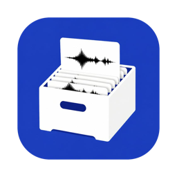
</p>

<h1 align="center">Open Libary</h1>

<p align="center">
  A sample library for producers that runs on your own computer.<br>
  It searches your sample folders, plays instantly, and you drag sounds straight into your DAW.
</p>

<p align="center">
  <a href="https://github.com/Kflsox/open-libary/releases/latest"><b>Download</b></a> for macOS, Windows and Linux
  &nbsp;·&nbsp; <a href="GUIDE.md">Setup guide</a>
  &nbsp;·&nbsp; <a href="LICENSE">AGPL-3.0</a>
</p>

<picture>
  <source media="(prefers-color-scheme: dark)" srcset="docs/media/library-dark.png">
  
</picture>

It also finds free sounds on the web and adds them to your library with a license record. No account, no cloud, your
files stay where they are. The interface is in English and German: Settings > Language switches it, and the app menus
switch along with it.

The name is "Libary" on purpose: "Open Library" is already the Internet Archive's book catalog.

## Watch it with sound

https://github.com/user-attachments/assets/0a093a3d-b5d1-46bc-969c-b65105f9cb4c

Kicks and 808s by ear with the arrow keys, then a project at 140 BPM in F minor, then loops stacked over a drum loop
that keeps running as backing track. The video and the library pictures use a demo library synthesized for this page,
no third-party samples.

## Find

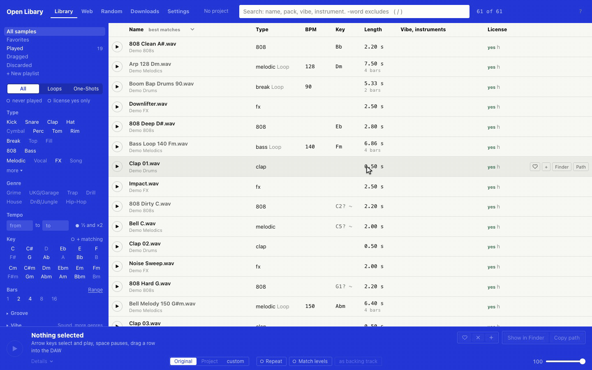

Search by name, pack, vibe or instrument, then narrow it down by type (Kick, Snare, 808, Loop, One-Shot …), tempo, key
and bars. **Similar** (`s`) lists sounds like the one that is playing, from the same pack first. Favorites, playlists,
notes with clickable timestamps and everything you played, dragged or discarded sit in the left column.

Your folders can hold WAV, AIFF, FLAC, MP3 and OGG, FL Studio's factory samples included; nothing gets moved. Tempo
and key come from the file name first. Where the name says nothing, Open Libary measures without extra programs: the
tempo of loops, the root note of 808, bass and tonal one-shots, and a rough sound fingerprint for Similar. Estimated
values carry a "~" in the list.

## Listen

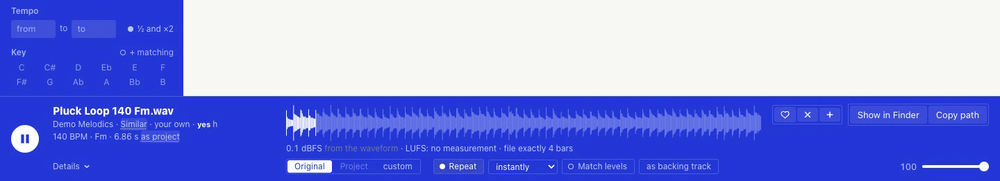

A row plays the moment you select it, with its waveform. Drag across the waveform to mark a region: the loop runs only
over it, snapped to bars, and only the region goes into the DAW. A **project** (tempo and key in the header) presets the
filters in Library, Random and Web and lets a loop play matched to it in tempo and key (this needs ffmpeg and
rubberband). **As backing track** keeps the playing loop running while you try other loops on top of it.

## Random

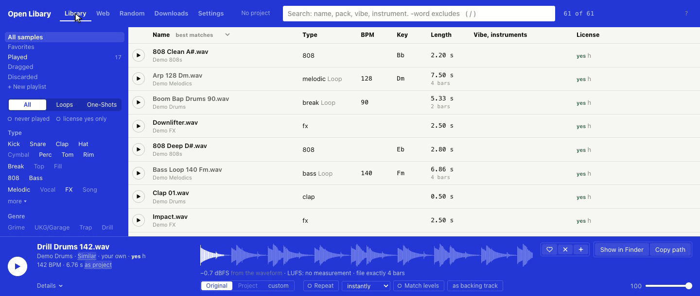

One loop at a time, for browsing without a plan. The right arrow brings the next one; filters narrow it to drums,
melodies or percussion, a tempo range or a key. Drag the card into the DAW to keep the loop.

## Drag into the DAW

FL Studio, Ableton Live, Logic, Cubase, Studio One, Reaper, Bitwig and Pro Tools. Formats a DAW cannot read (OGG and
FLAC in Logic and Pro Tools, FL Studio's factory samples outside FL) are handed over as WAV. Dragging works in the
apps, not in the browser.

## Free sounds from the web

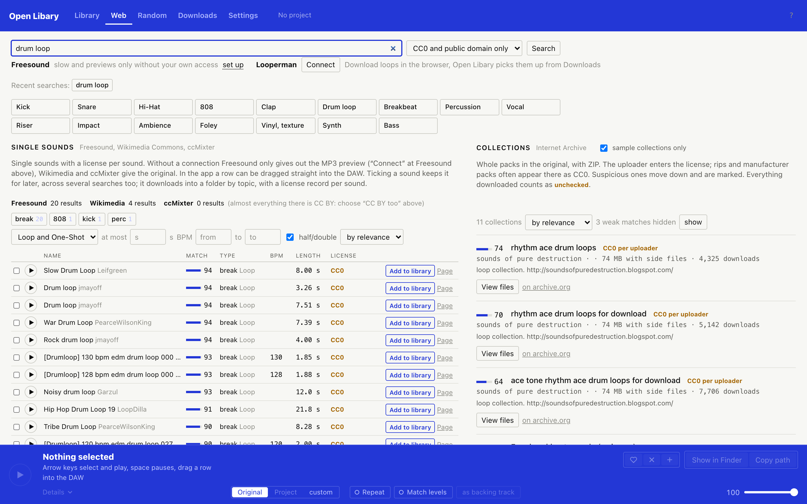

Single sounds from Freesound, Wikimedia Commons and ccMixter, whole packs from the Internet Archive. Only CC0, CC BY
and public domain; every download comes with a license record. Packs from the Internet Archive carry the license their
uploader entered, so they count as unchecked until you clear them. Freesound optionally with your own account (original
files instead of previews), Looperman through your own browser.

## Sort out licenses

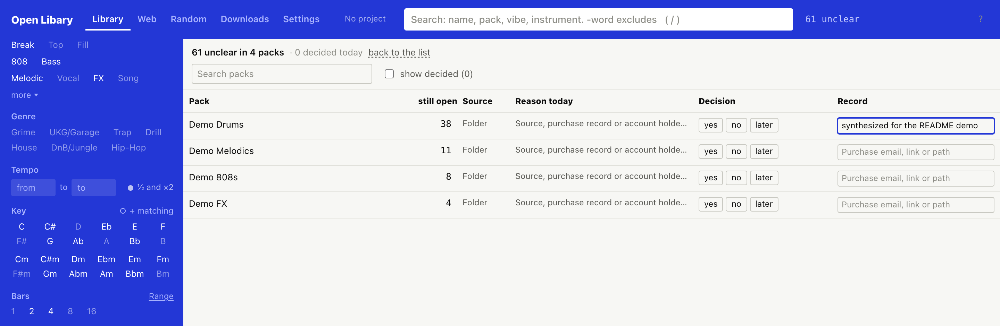

For your own folders you record, pack by pack, whether you may use the sounds: yes, no or later, with the purchase
email, link or path as the record. The switch "license yes only" then hides everything you have not cleared. Values
set by hand carry an "h" in the list.

## Six looks

<table>
  <tr>
    <td width="33%">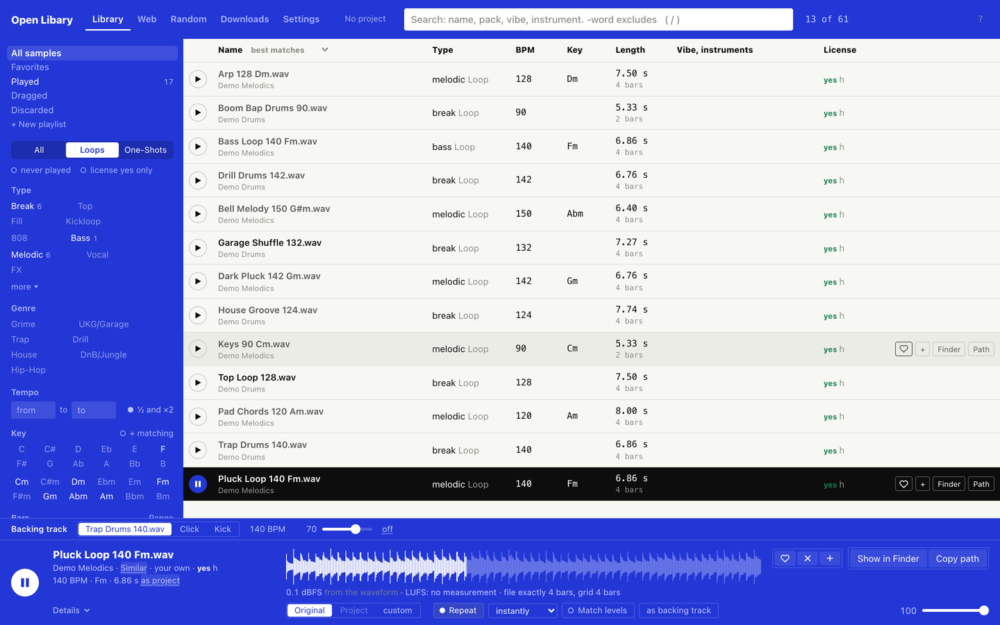<br><b>Cobalt</b> (default)</td>
    <td width="33%">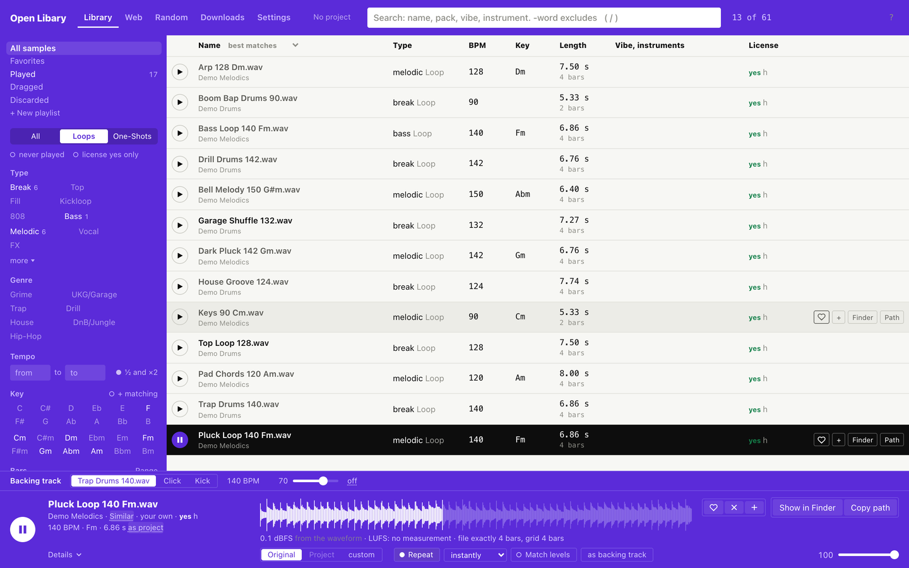<br><b>Violet</b></td>
    <td width="33%">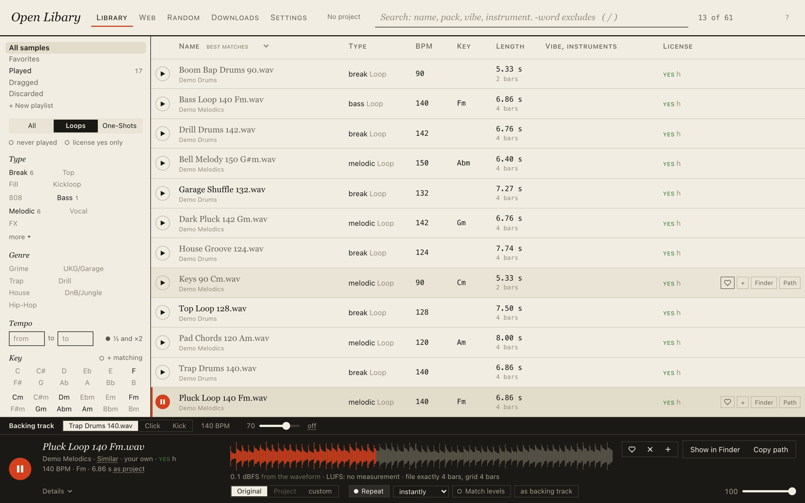<br><b>Score</b></td>
  </tr>
  <tr>
    <td>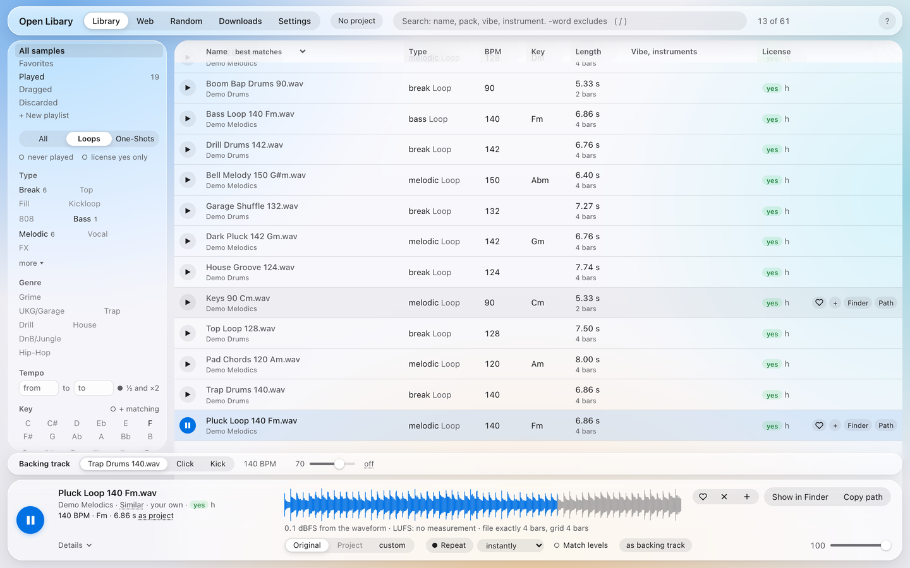<br><b>Liquid Glass</b></td>
    <td>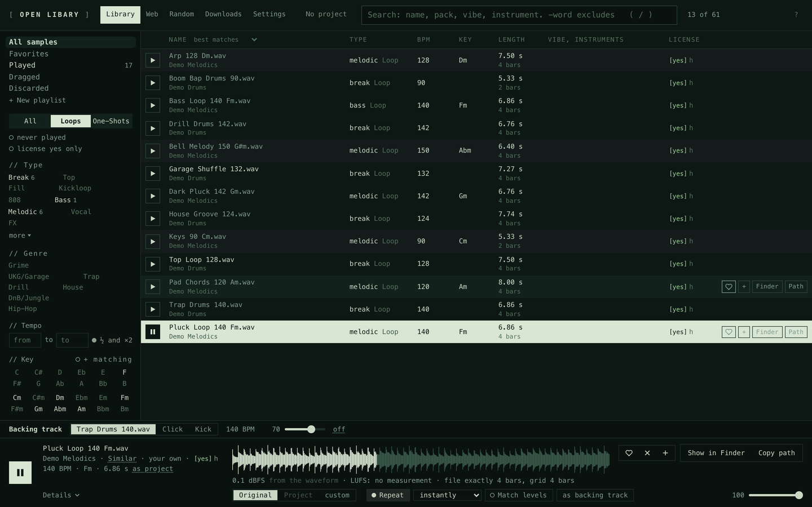<br><b>Tracker</b></td>
    <td>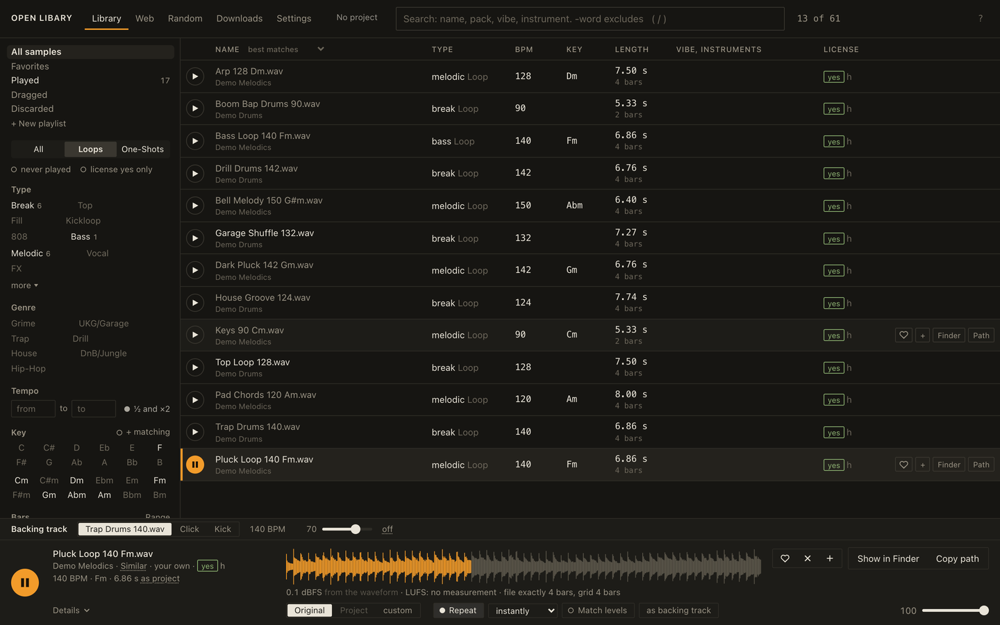<br><b>Workshop</b></td>
  </tr>
</table>

Settings > Appearance. Liquid Glass also goes on top of any of the color styles.

## Keys

| Key | Does |
|---|---|
| `↓` `↑` | play the next, the previous row |
| `Space` | pause and resume a loop, retrigger a one-shot |
| `s` | similar sounds |
| `l` | repeat on, off |
| `u` | the playing loop becomes the backing track |
| `t` | original or matched to the project |
| `h` `p` `x` | favorite, add to a playlist, discard |
| `n` | note on the sample, times like 0:42 jump there |
| `b` | tap the project tempo |
| `?` | all shortcuts |

## Setup

The finished apps (Mac from macOS 10.15, Apple chip and Intel; Windows 10 and 11; Linux as .deb and tar.gz) bring
everything they need, nothing has to be installed. Download them from the
[latest release](https://github.com/Kflsox/open-libary/releases/latest). Step by step, including what to do the first
time you open an unsigned app: [GUIDE.md](GUIDE.md).

Only matching loops to the project tempo and key uses two programs the apps do not include: ffmpeg and rubberband
(Mac with Homebrew: `brew install ffmpeg rubberband`). Open Libary uses them when they are installed; everything else
works without them.

From source (Python 3.9 or newer; the analysis also needs `numpy` and `soundfile`):

```
OPENLIBARY_DATEN=~/.local/share/open-libary python3 openlibary.py
```

Then `http://127.0.0.1:8765/` opens in the browser. Dragging into the DAW works only in the apps, not in the browser.

## Building the apps

```
bash app/pythons_holen.sh                         # standalone Pythons with numpy and soundfile (needs uv)
bash app/app_paket.sh <target folder>             # Mac, Universal (Objective-C shell, needs the Command Line Tools)
cd app/fenster && npm ci && cd ../..
bash app/fenster_paket.sh windows <target folder> # Windows x64 (Electron)
bash app/fenster_paket.sh linux <target folder>   # Linux x64, .deb and tar.gz
```

## Testing

`python tests/rauchtest.py` is the smoke test: it builds a small test library from synthetic sounds, starts the server
and checks scanning, durations, playback of every format, analysis, WAV on drag, the interface language and a
second start. `python tests/check_translations.py` checks that every text has an entry in each `lang/*.json`. The workflow
"Check" (`.github/workflows/pruefen.yml`) runs it on Windows, Ubuntu and Mac (Apple chip and Intel) and, on request,
also builds and starts the finished apps.

## Translations

The texts live in `lang/<code>.json`: one JSON object that maps each English text to its translation, one entry per
text. Placeholders such as `{n}` stay as they are. A text without an entry shows in English.

To add a language: copy `lang/de.json` to `lang/<code>.json`, translate the values (not the keys), and add the code
with the language's own name to `LANGUAGES` in `i18n.py`. `python tests/check_translations.py` lists every text that is still missing.

## License

GNU Affero General Public License, version 3 or later ([LICENSE](LICENSE)). Third-party software that the apps
include is listed in [THIRD_PARTY.md](THIRD_PARTY.md).
